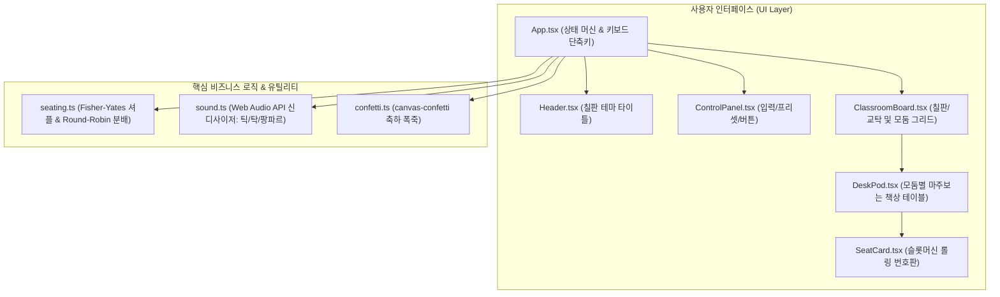

# 우리 반 자리 뽑기 웹앱 (Classroom Random Seat Picker) Implementation Plan

> **For agentic workers:** REQUIRED SUB-SKILL: Use superpowers:subagent-driven-development to implement this plan task-by-task. Steps use checkbox (`- [ ]`) syntax for tracking.

**Goal:** 학생 수와 모둠 수를 입력받아 1번부터 N번까지의 학생 번호를 중복 없이 무작위 셔플하고, 슬롯머신 스타일의 순차적 롤링 애니메이션과 실감 나는 Web Audio 효과음, 색종이 폭죽 연출을 통해 교실 칠판/교탁 기준 모둠별 마주보는 자리 배치표를 시각화하는 반응형 웹앱을 구축한다.

**Architecture:** React 18, TypeScript, Vite, Tailwind CSS 기반의 모듈형 구조. 핵심 알고리즘(셔플 및 공평 분배)과 사운드 합성기(Web Audio API), 파티클 폭죽(canvas-confetti)을 독립 유틸리티로 격리하여 TDD로 검증하며, 교탁/칠판 헤더와 모둠별 카드(DeskPod), 번호 롤링 카드(SeatCard) 컴포넌트로 합성한다.

**Architecture Diagram:**



**Tech Stack:** React 18, TypeScript, Vite, Tailwind CSS, Lucide React, canvas-confetti, Vitest, @testing-library/react

## Global Constraints
- React 18 + Vite + TypeScript 표준 구조 준수
- 외부 오디오 파일 요청 없이 순수 브라우저 Web Audio API로 효과음 생성
- 학생 이름 입력 배제, 1번~N번 번호로만 일관되게 표시
- 학생 수가 모둠 수보다 적을 때의 유효성 검증 및 버튼 잠금 처리
- 롤링 중 중복 클릭 방지 처리

---

### Task 1: Project Scaffolding & Setup

**Files:**
- Create: `package.json`, `vite.config.ts`, `tsconfig.json`, `tsconfig.node.json`, `index.html`, `postcss.config.js`, `tailwind.config.js`, `src/index.css`, `src/main.tsx`, `src/test/setup.ts`
- Test: `vitest.config.ts`

**Interfaces:**
- Produces: 빌드 환경, 테스트 러너, Tailwind CSS 스타일 설정

- [ ] **Step 1: package.json 생성 및 의존성 구성**
```json
{
  "name": "random-seat",
  "private": true,
  "version": "1.0.0",
  "type": "module",
  "scripts": {
    "dev": "vite",
    "build": "tsc && vite build",
    "preview": "vite preview",
    "test": "vitest run"
  },
  "dependencies": {
    "canvas-confetti": "^1.9.4",
    "clsx": "^2.1.1",
    "lucide-react": "^1.16.0",
    "react": "^18.3.1",
    "react-dom": "^18.3.1",
    "tailwind-merge": "^3.5.0"
  },
  "devDependencies": {
    "@testing-library/jest-dom": "^6.9.1",
    "@testing-library/react": "^16.3.2",
    "@types/canvas-confetti": "^1.9.0",
    "@types/node": "^22.19.16",
    "@types/react": "^18.3.28",
    "@types/react-dom": "^18.3.7",
    "@vitejs/plugin-react": "^4.7.0",
    "autoprefixer": "^10.4.27",
    "jsdom": "^27.4.0",
    "postcss": "^8.5.8",
    "tailwindcss": "^3.4.19",
    "typescript": "^5.9.3",
    "vite": "^5.4.21",
    "vitest": "^2.1.9"
  }
}
```

- [ ] **Step 2: Vite, TypeScript, Tailwind 설정 파일 생성**
`vite.config.ts`, `tailwind.config.js`, `postcss.config.js`, `tsconfig.json`, `index.html`, `src/index.css`, `src/test/setup.ts` 생성.

- [ ] **Step 3: 패키지 설치 및 스모크 테스트 실행**
Run: `npm install` 및 `npm run test`
Expected: 0 errors, Vitest 정상 실행

- [ ] **Step 4: Commit**
```bash
git add package.json vite.config.ts tsconfig*.json postcss.config.js tailwind.config.js index.html src/
git commit -m "chore: scaffold vite react typescript project with tailwind and vitest"
```

---

### Task 2: Seating Logic & Distribution Algorithm (TDD)

**Files:**
- Create: `src/utils/seating.ts`
- Test: `src/utils/seating.test.ts`

**Interfaces:**
- Produces:
  ```typescript
  export interface PodSeatGroup {
    groupIndex: number; // 0-based
    groupName: string; // "1모둠", "2모둠"
    seatNumbers: number[]; // e.g. [14, 2, 8, 21]
  }
  export function generateSeatingPlan(studentCount: number, groupCount: number): PodSeatGroup[];
  export function shuffleArray<T>(array: T[]): T[];
  ```

- [ ] **Step 1: Write failing unit tests for seating distribution**
```typescript
// src/utils/seating.test.ts
import { describe, it, expect } from 'vitest';
import { generateSeatingPlan, shuffleArray } from './seating';

describe('seating utility', () => {
  it('shuffles array without modifying original elements', () => {
    const input = [1, 2, 3, 4, 5];
    const shuffled = shuffleArray(input);
    expect(shuffled).toHaveLength(5);
    expect([...shuffled].sort()).toEqual([1, 2, 3, 4, 5]);
  });

  it('distributes 24 students into 6 groups evenly (4 students each)', () => {
    const plan = generateSeatingPlan(24, 6);
    expect(plan).toHaveLength(6);
    plan.forEach((group, idx) => {
      expect(group.groupName).toBe(`${idx + 1}모둠`);
      expect(group.seatNumbers).toHaveLength(4);
    });
    const allSeats = plan.flatMap(g => g.seatNumbers).sort((a, b) => a - b);
    expect(allSeats).toEqual(Array.from({ length: 24 }, (_, i) => i + 1));
  });

  it('distributes 25 students into 6 groups fairly (5, 4, 4, 4, 4, 4)', () => {
    const plan = generateSeatingPlan(25, 6);
    expect(plan).toHaveLength(6);
    expect(plan[0].seatNumbers).toHaveLength(5);
    for (let i = 1; i < 6; i++) {
      expect(plan[i].seatNumbers).toHaveLength(4);
    }
    const allSeats = plan.flatMap(g => g.seatNumbers).sort((a, b) => a - b);
    expect(allSeats).toEqual(Array.from({ length: 25 }, (_, i) => i + 1));
  });

  it('handles invalid inputs gracefully', () => {
    expect(generateSeatingPlan(0, 5)).toEqual([]);
    expect(generateSeatingPlan(5, 0)).toEqual([]);
    expect(generateSeatingPlan(3, 5)).toHaveLength(3); // capped at student count
  });
});
```

- [ ] **Step 2: Run test to verify it fails**
Run: `npm run test`
Expected: FAIL (Cannot find module `./seating`)

- [ ] **Step 3: Implement minimal code in `src/utils/seating.ts`**
```typescript
// src/utils/seating.ts
export interface PodSeatGroup {
  groupIndex: number;
  groupName: string;
  seatNumbers: number[];
}

export function shuffleArray<T>(array: T[]): T[] {
  const result = [...array];
  for (let i = result.length - 1; i > 0; i--) {
    const j = Math.floor(Math.random() * (i + 1));
    [result[i], result[j]] = [result[j], result[i]];
  }
  return result;
}

export function generateSeatingPlan(studentCount: number, groupCount: number): PodSeatGroup[] {
  if (studentCount <= 0 || groupCount <= 0) return [];
  const validGroups = Math.min(groupCount, studentCount);

  const students = Array.from({ length: studentCount }, (_, i) => i + 1);
  const shuffled = shuffleArray(students);

  const baseCount = Math.floor(studentCount / validGroups);
  const remainder = studentCount % validGroups;

  const result: PodSeatGroup[] = [];
  let currentIndex = 0;

  for (let g = 0; g < validGroups; g++) {
    const size = g < remainder ? baseCount + 1 : baseCount;
    const groupSeats = shuffled.slice(currentIndex, currentIndex + size);
    currentIndex += size;

    result.push({
      groupIndex: g,
      groupName: `${g + 1}모둠`,
      seatNumbers: groupSeats
    });
  }

  return result;
}
```

- [ ] **Step 4: Run test to verify it passes**
Run: `npm run test`
Expected: PASS (4 passed)

- [ ] **Step 5: Commit**
```bash
git add src/utils/seating.ts src/utils/seating.test.ts
git commit -m "feat: implement seating shuffle and round-robin distribution with tests"
```

---

### Task 3: Web Audio Synthesizer & Confetti Effects

**Files:**
- Create: `src/utils/sound.ts`, `src/utils/confetti.ts`
- Test: `src/utils/sound.test.ts`

**Interfaces:**
- Produces:
  ```typescript
  export class SoundEffects {
    constructor(enabled?: boolean);
    setEnabled(enabled: boolean): void;
    playTick(): void;
    playLock(): void;
    playFanfare(): void;
  }
  export function fireConfetti(): void;
  ```

- [ ] **Step 1: Write tests for SoundEffects class state management**
```typescript
// src/utils/sound.test.ts
import { describe, it, expect, vi } from 'vitest';
import { SoundEffects } from './sound';

describe('SoundEffects', () => {
  it('manages enabled state correctly', () => {
    const sfx = new SoundEffects(true);
    expect(sfx.isEnabled()).toBe(true);
    sfx.setEnabled(false);
    expect(sfx.isEnabled()).toBe(false);
  });

  it('does not throw when audio context is unavailable or muted', () => {
    const sfx = new SoundEffects(false);
    expect(() => sfx.playTick()).not.toThrow();
    expect(() => sfx.playLock()).not.toThrow();
    expect(() => sfx.playFanfare()).not.toThrow();
  });
});
```

- [ ] **Step 2: Run test to verify it fails**
Run: `npm run test`
Expected: FAIL

- [ ] **Step 3: Implement `src/utils/sound.ts` & `src/utils/confetti.ts`**
Web Audio API oscillator 기반 Tick, Lock, Fanfare 사운드 및 `canvas-confetti` 3-stage blast 구현.

- [ ] **Step 4: Run test to verify it passes**
Run: `npm run test`
Expected: PASS

- [ ] **Step 5: Commit**
```bash
git add src/utils/sound.ts src/utils/sound.test.ts src/utils/confetti.ts
git commit -m "feat: implement Web Audio synthesizer and confetti particle system"
```

---

### Task 4: SeatCard Component & Rolling Animation

**Files:**
- Create: `src/components/SeatCard.tsx`
- Test: `src/components/SeatCard.test.tsx`

**Interfaces:**
- Consumes: `number`, `isLocked: boolean`, `displayNumber: number`, `groupColor: string`
- Produces: 개별 좌석 카드 렌더링, 롤링 중 모션(`animate-bounce`/`scale`), 고정 시 하이라이트

- [ ] **Step 1: Write test for SeatCard**
```typescript
// src/components/SeatCard.test.tsx
import { render, screen } from '@testing-library/react';
import { describe, it, expect } from 'vitest';
import { SeatCard } from './SeatCard';

describe('SeatCard', () => {
  it('renders locked seat number with label', () => {
    render(<SeatCard seatNumber={7} isLocked={true} isRolling={false} />);
    expect(screen.getByText('7번')).toBeInTheDocument();
  });

  it('renders rolling placeholder when not locked', () => {
    render(<SeatCard seatNumber={12} isLocked={false} isRolling={true} />);
    expect(screen.getByText('12번')).toBeInTheDocument();
  });
});
```

- [ ] **Step 2: Run test to verify it fails**
Run: `npm run test`
Expected: FAIL

- [ ] **Step 3: Implement SeatCard component with smooth styles**
`src/components/SeatCard.tsx` 작성.

- [ ] **Step 4: Run test to verify it passes**
Run: `npm run test`
Expected: PASS

- [ ] **Step 5: Commit**
```bash
git add src/components/SeatCard.tsx src/components/SeatCard.test.tsx
git commit -m "feat: create SeatCard component with rolling animation styles"
```

---

### Task 5: DeskPod & ClassroomBoard Components

**Files:**
- Create: `src/components/DeskPod.tsx`, `src/components/ClassroomBoard.tsx`
- Test: `src/components/ClassroomBoard.test.tsx`

**Interfaces:**
- Consumes: `PodSeatGroup[]`, `lockedGroups: Set<number>`, `rollingNumbers: Record<string, number>`
- Produces: 칠판/교탁 상단 배너, 모둠별 마주보는 2열 책상 배치 컨테이너

- [ ] **Step 1: Write tests for ClassroomBoard layout**
- [ ] **Step 2: Run test to verify it fails**
- [ ] **Step 3: Implement DeskPod & ClassroomBoard**
- [ ] **Step 4: Run test to verify it passes**
- [ ] **Step 5: Commit**
```bash
git add src/components/DeskPod.tsx src/components/ClassroomBoard.tsx src/components/ClassroomBoard.test.tsx
git commit -m "feat: build classroom chalkboard and facing desk pod grid"
```

---

### Task 6: Header, ControlPanel & Quick Presets

**Files:**
- Create: `src/components/Header.tsx`, `src/components/ControlPanel.tsx`
- Test: `src/components/ControlPanel.test.tsx`

**Interfaces:**
- Consumes: `studentCount`, `groupCount`, `onStudentChange`, `onGroupChange`, `onRoll`, `onReset`, `isRolling`, `soundEnabled`, `onToggleSound`
- Produces: 학생 수/모둠 수 인풋 필드, 자주 쓰는 학급 프리셋 버튼(20/4, 24/6, 28/7, 30/6), [자리 뽑기]/[다시 뽑기] 버튼

- [ ] **Step 1: Write tests for ControlPanel validation and actions**
- [ ] **Step 2: Run test to verify it fails**
- [ ] **Step 3: Implement Header and ControlPanel**
- [ ] **Step 4: Run test to verify it passes**
- [ ] **Step 5: Commit**
```bash
git add src/components/Header.tsx src/components/ControlPanel.tsx src/components/ControlPanel.test.tsx
git commit -m "feat: implement header and interactive control panel with presets"
```

---

### Task 7: App Integration, Animation Controller & E2E Verification

**Files:**
- Create/Modify: `src/App.tsx`, `src/App.test.tsx`, `src/index.css`
- Assets: print media queries for clean A4 printing

**Interfaces:**
- Consumes: 모든 하위 컴포넌트 및 유틸
- Produces: 완전한 자리 배치 웹 애플리케이션, 키보드 단축키(Space/Enter) 리스너, 인쇄 및 전체화면 기능

- [ ] **Step 1: Write integrated App test for roll and reset workflow**
- [ ] **Step 2: Implement full App.tsx state machine & sequential locking animation**
- [ ] **Step 3: Run full test suite and verify 100% passing**
Run: `npm run test`
- [ ] **Step 4: Build test for production asset verification**
Run: `npm run build`
- [ ] **Step 5: Visual and interactive browser testing**
- [ ] **Step 6: Commit**
```bash
git add src/App.tsx src/App.test.tsx src/index.css
git commit -m "feat: integrate full seat picker app with sequential rolling and shortcuts"
```
